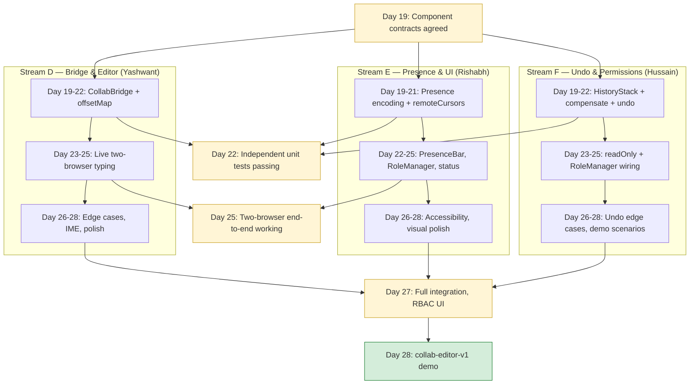
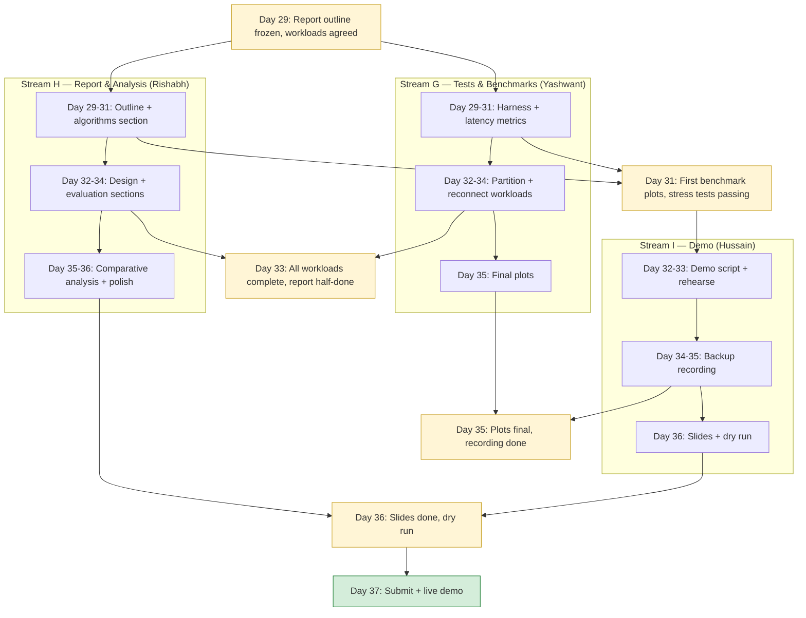

# Phases 3 & 4 — Plan, Components, and Workflow

## Phase 3 — Editor Integration | Days 19–28 | Prototype: `collab-editor-alpha` → `collab-editor-v1`

### What this phase delivers

Phase 3 turns the headless `collab-sync` client into a visible, usable editor. It wraps `ClientSync` with a CodeMirror 6 editor view, paints remote cursors and selections, adds a local undo/redo stack, and surfaces role-based UI affordances (read-only mode for viewers, role-management UI for owners).

The `crdt-engine` and `collab-sync` packages are not modified. Phase 3 consumes them as libraries.

### Phase 3 builds on Phase 2

| Phase 2 export | Phase 3 consumer |
|---|---|
| `ClientSync` | The `useCollabClient` React hook wraps it |
| `ClientSync.onOpsApplied` | `CollabBridge` translates each applied op into a CodeMirror dispatch |
| `ClientSync.insert` / `delete` | Called from CodeMirror's transaction listener |
| `ClientSync.replica.lww` (via `setMeta`) | Cursor positions and presence are stored as LWW metadata fields |
| `ClientSync.getRole()` | Drives editor read-only state for viewers |
| `ClientSync.mintToken` (the relay handler) | Triggered by the role-management UI |

### Directory structure

```
collab-editor/
├── src/
│   ├── bridge/
│   │   ├── CollabBridge.ts           Translates CM6 transactions ↔ CRDT ops
│   │   ├── offsetMap.ts              RGA NodeId ↔ CM6 visible offset translation
│   │   └── presence.ts               Cursor / selection LWW field encode/decode
│   ├── editor/
│   │   ├── EditorView.tsx            React component wrapping CodeMirror 6
│   │   ├── extensions/
│   │   │   ├── remoteCursors.ts      CM6 extension: render peer carets/selections
│   │   │   ├── readOnly.ts           CM6 extension: enforce viewer read-only
│   │   │   └── undoRedo.ts           CM6 extension: local-only undo/redo stack
│   │   └── theme.ts                  Editor styling tokens
│   ├── hooks/
│   │   ├── useCollabClient.ts        Connect/disconnect lifecycle for ClientSync
│   │   └── usePresence.ts            Subscribe to peer cursor / selection updates
│   ├── ui/
│   │   ├── App.tsx                   Top-level layout: editor + sidebar + status
│   │   ├── PresenceBar.tsx           Avatars + colored dots for online peers
│   │   ├── RoleManager.tsx           Owner-only: invite, change roles, copy tokens
│   │   ├── ConnectionStatus.tsx      "online / offline / reconnecting" indicator
│   │   └── DocumentTitle.tsx         Bound to LWW title field
│   ├── undo/
│   │   ├── HistoryStack.ts           Local stack of compensating ops
│   │   └── compensate.ts             Build inverse op for an insert/delete
│   ├── main.tsx                      React entry point
│   └── index.html
└── tests/
    ├── bridge/
    │   ├── CollabBridge.test.ts      Single-keystroke → op → applied roundtrip
    │   ├── offsetMap.test.ts         Translation under remote inserts/deletes
    │   └── presence.test.ts          Cursor field round trip through LWW
    ├── extensions/
    │   ├── remoteCursors.test.ts     Peer caret rendered at correct visible offset
    │   └── readOnly.test.ts          Viewer cannot dispatch document changes
    ├── undo/
    │   ├── HistoryStack.test.ts      Stack push/pop, capacity bounds
    │   └── compensate.test.ts        Inverse op semantics
    └── integration/
        └── two-client-typing.test.ts Two browser-like clients, real relay, type+converge
```

### Component descriptions

**`bridge/CollabBridge.ts`** — The seam between CodeMirror's transaction system and `ClientSync`. Listens to CM6 `update` events, decodes inserted/deleted text from the changeset, and calls `client.insert(offset, char)` / `client.delete(offset)` for each. In the other direction, subscribes to `client.onOpsApplied` and dispatches each op as a CM6 transaction with `userEvent: "remote"` so the local change-listener can ignore them and avoid an infinite loop.

**`bridge/offsetMap.ts`** — RGA addresses positions by NodeId. CodeMirror addresses positions by visible offset. This module maintains the bidirectional translation, kept consistent across remote inserts and deletes (which shift offsets without firing CM6 transactions).

**`bridge/presence.ts`** — Encodes a cursor as a `{ nodeId: NodeId, offsetWithinNode: 0|1 }` pair stored under `cursor:<siteId>` in the LWW register. The NodeId reference makes cursors stable across remote edits — a cursor "sticks" to the character it was after, even if other characters get inserted before it. Selection ranges encode as `{ anchor, head }` pairs.

**`editor/EditorView.tsx`** — A React component that mounts a CodeMirror 6 editor and wires its lifecycle to a `useCollabClient` hook. Receives the `ClientSync` instance via props and instantiates `CollabBridge` on mount.

**`editor/extensions/remoteCursors.ts`** — A CM6 view plugin that watches `usePresence()` output and paints DOM widgets at each peer's cursor position. Selections render as colored ranges. Each peer gets a deterministic color hashed from siteId.

**`editor/extensions/readOnly.ts`** — Inspects `client.getRole()` and, for viewers, attaches CM6's `EditorState.readOnly` facet so the editor refuses keystrokes.

**`editor/extensions/undoRedo.ts`** — Hooks Cmd-Z / Ctrl-Z. Pops from `HistoryStack` and dispatches the compensating op. Crucially this is *local* undo only — it doesn't undo other users' edits.

**`hooks/useCollabClient.ts`** — Encapsulates `new ClientSync(...)`, `connect()`, `disconnect()`, and lifecycle cleanup. Exposes the client instance and connection state to children.

**`hooks/usePresence.ts`** — Subscribes to `client.onMetaChanged`, filters for `cursor:*` and `selection:*` fields, returns a map keyed by siteId. Re-renders subscribers when peers move.

**`ui/PresenceBar.tsx`** — Renders avatars/dots for currently-connected peers, using `client.onSiteJoined` / `onSiteLeft` to update.

**`ui/RoleManager.tsx`** — Owner-only panel. Shows current peers with their roles, lets the owner promote/demote, and provides a "create invite token" flow that calls `client.mintToken(siteId, role)` and copies the resulting token to the clipboard.

**`ui/ConnectionStatus.tsx`** — Subscribes to `client.onConnectionChange` and renders a status pill with traffic-light coloring.

**`ui/DocumentTitle.tsx`** — Two-way binding to `client.replica.lww.get("title")` / `client.setMeta("title", ...)`. Debounced so every keystroke doesn't fire a meta broadcast.

**`undo/HistoryStack.ts`** — A bounded stack of compensating ops. Each local edit pushes its inverse. Cmd-Z pops one and dispatches it. Bounded to ~100 entries to cap memory.

**`undo/compensate.ts`** — Given an `RGAInsert`, return an `RGADelete` for the same NodeId. Given an `RGADelete`, return an `RGAInsert` of the same character at the same position (re-using the original NodeId is impossible since RGA assigns fresh ones; instead the inverse insert generates a new node and the undo "appears" as if the original was restored, which is good enough for local UX).

### Phase 3 work distribution

Phase 3 has three streams running in parallel for days 19–25, then converging on integration days 26–28.

#### Stream D — Bridge & Editor View (Days 19–28) — Yashwant
The CodeMirror integration core. `bridge/`, `editor/EditorView.tsx`, basic React shell.
Days 19–22: `CollabBridge`, `offsetMap`, basic `EditorView` rendering text from a static `Replica`.
Days 23–25: Wire up `useCollabClient` to a real relay. Two-browser convergence demo working.
Days 26–28: Polish, edge cases (rapid typing, IME), integration test.

#### Stream E — Presence & UI (Days 19–28) — Rishabh
Cursor presence, peer awareness, role-management UI.
Days 19–21: `presence.ts` encoding, `usePresence` hook, `remoteCursors` extension.
Days 22–25: `PresenceBar`, `RoleManager`, `ConnectionStatus`, `DocumentTitle`.
Days 26–28: Visual polish, accessibility pass.

#### Stream F — Undo & Permissions (Days 19–28) — Hussain
Local undo/redo, viewer read-only mode, RBAC enforcement on the client side.
Days 19–22: `compensate.ts`, `HistoryStack`, `undoRedo` CM6 extension.
Days 23–25: `readOnly` extension, integration with `RoleManager`.
Days 26–28: Edge cases (undo across remote inserts), demo scenarios.

### Phase 3 coordination checkpoints

| Day | Sync point |
|---|---|
| 19 | Component contracts agreed (CollabBridge API, presence encoding, history stack interface) |
| 22 | Stream D: single-client editor types text. Stream E: cursor field round-trips through LWW. Stream F: local undo works with no network. |
| 25 | Two-browser convergence working end-to-end (D + relay). Cursor presence visible (E). |
| 27 | Full feature integration. Role-aware UI. Owner can mint editor/viewer tokens from the panel. |
| 28 | `collab-editor-v1` demo: three browsers, real-time edits, presence, partition/heal, role enforcement |

### Phase 3 workflow — Mermaid



### Phase 3 workflow — ASCII

```
                    Day 19 ── component contracts agreed
                              │
        ┌─────────────────────┼─────────────────────┐
        ▼                     ▼                     ▼
  Stream D (Yashwant)   Stream E (Rishabh)    Stream F (Hussain)
  Bridge & Editor      Presence & UI          Undo & Permissions
        │                     │                     │
  D19-22                 D19-21                 D19-22
  CollabBridge           Presence encoding      HistoryStack
  offsetMap              remoteCursors ext      compensate
        │                     │                     │
  D23-25                 D22-25                 D23-25
  Live typing            PresenceBar            readOnly extension
  two browsers           RoleManager UI         RoleManager wiring
                         ConnectionStatus
        │                     │                     │
  D26-28                 D26-28                 D26-28
  Edge cases, IME        A11y, polish           Undo edge cases
        │                     │                     │
        └─────────────────────┼─────────────────────┘
                              ▼
                    Day 28 ── collab-editor-v1 demo
                              3 browsers, presence, RBAC, partition/heal
```

---

## Phase 4 — Testing, Benchmarking, Documentation | Days 29–37 | Final deliverable: course report + live demo

### What this phase delivers

Phase 4 produces the report-grade artifacts and the live demo. No new features. The goal is to gather the evidence that the prototype works, characterize its performance, and write the deliverables.

### Directory structure

```
project-root/
├── crdt-engine/                  Phase 1 (frozen)
├── collab-sync/                  Phase 2 (frozen)
├── collab-editor/                Phase 3 (frozen)
├── benchmarks/
│   ├── src/
│   │   ├── harness.ts            Common driver — spin up N clients, generate workload
│   │   ├── workloads/
│   │   │   ├── concurrentTyping.ts    All clients type simultaneously
│   │   │   ├── partitionHeal.ts       Repeated partition/heal cycles
│   │   │   ├── largeDoc.ts            10k-character document, mid-doc edits
│   │   │   └── reconnectStorm.ts      Many clients reconnecting at once
│   │   ├── metrics/
│   │   │   ├── latency.ts             Op-to-visible latency histogram
│   │   │   ├── throughput.ts          Ops/second sustained
│   │   │   ├── convergenceTime.ts     Time from last edit to all-replicas-equal
│   │   │   └── memoryFootprint.ts     RGA node count, tombstones, log size
│   │   └── runners/
│   │       ├── runRga.ts              Workloads against RGA
│   │       └── runLww.ts              Workloads against LWW (limited — single field)
│   └── results/
│       ├── *.json                Raw measurements
│       └── *.md                  Plotted summaries
├── tests/integration-stress/
│   ├── 10-clients-10k-ops.test.ts     The headline convergence stress test
│   ├── partition-storm.test.ts        Repeated partition/heal cycles
│   └── reconnect-replay.test.ts       Late joiner replay correctness
├── docs/
│   ├── REPORT.md                 Full course report (algorithms, design, results)
│   ├── COMPARATIVE_ANALYSIS.md   RGA vs LWW empirical comparison
│   ├── DEMO_SCRIPT.md            Step-by-step walkthrough for the live demo
│   └── figures/                  Diagrams, plots, screenshots
└── presentation/
    ├── slides.md                 Source for the demo-day slides
    └── demo-recording.mp4        Backup recording in case live demo fails
```

### Component descriptions

**`benchmarks/src/harness.ts`** — Common driver. Takes a workload spec, spins up N `ClientSync` instances against a real `RelayServer`, runs the workload, collects metrics, writes JSON.

**`benchmarks/src/workloads/concurrentTyping.ts`** — All N clients type 100 characters simultaneously. Measures convergence time, op throughput, peak memory.

**`benchmarks/src/workloads/partitionHeal.ts`** — Cycles each client through online→offline→online with 5-second offline windows. Stresses the relay op log and offline queue. Measures missed-op count, replay time on rejoin.

**`benchmarks/src/workloads/largeDoc.ts`** — Pre-loads a 10k-character document, then runs concurrent mid-document edits. Stresses RGA's offset/NodeId translation and the tombstone GC.

**`benchmarks/src/workloads/reconnectStorm.ts`** — Disconnects all clients simultaneously, reconnects them all within a 1-second window. Stresses the relay's join handshake throughput and replay path.

**`benchmarks/src/metrics/latency.ts`** — Tags each op with a generation timestamp, measures `applied_at - generated_at` on the receiving side. Outputs p50/p95/p99 histograms.

**`benchmarks/src/metrics/convergenceTime.ts`** — Polls all replicas after the workload ends; the convergence point is the first instant where all replicas have identical text.

**`tests/integration-stress/`** — Three named scenarios that must pass before the demo:
- 10 clients, 10k ops total (headline convergence claim)
- 100 partition/heal cycles in a row
- A client offline for the entire workload reconnects at the end and converges

**`docs/REPORT.md`** — The full course report. Sections: introduction, related work, algorithms (RGA, vector clocks, causal delivery, LWW with citations from Phase 1 README), system design (Phase 1 + 2 + 3), evaluation (Phase 4 results), discussion, conclusion.

**`docs/COMPARATIVE_ANALYSIS.md`** — Empirical RGA vs LWW comparison. Both are CRDTs; the system uses both for different reasons. This document explains why per-character RGA was chosen for the document body and per-field LWW for metadata, with measurements showing what would happen if the choices were reversed (LWW on body would lose concurrent edits; RGA on metadata fields would generate O(N) ops per title change).

**`docs/DEMO_SCRIPT.md`** — Minute-by-minute script for a 10-minute demo: open three browsers, paste a paragraph, type concurrently, partition one, edit on both sides, heal, show convergence. Includes the exact text to type at each step so the demo is reproducible and rehearsable.

**`presentation/slides.md`** — Demo-day slide deck. Title, problem, approach, system tour, results, lessons.

### Phase 4 work distribution

#### Stream G — Stress tests & benchmarks (Days 29–35) — Yashwant
Days 29–31: harness, latency/throughput metrics, RGA workload runner.
Days 32–34: partition/heal and reconnect-storm workloads, integration stress tests.
Day 35: produce final benchmark plots.

#### Stream H — Comparative analysis & report (Days 29–37) — Rishabh
Days 29–31: outline `REPORT.md`, draft algorithms section pulling from Phase 1 README.
Days 32–34: write design and evaluation sections, incorporate Stream G's plots.
Days 35–36: `COMPARATIVE_ANALYSIS.md`, polish the report.
Day 37: final read-through, send to instructor.

#### Stream I — Demo prep (Days 32–37) — Hussain
Days 32–33: `DEMO_SCRIPT.md`, rehearse the 10-minute walkthrough.
Days 34–35: record `demo-recording.mp4` as a backup.
Day 36: build slides, integrate with the report's narrative.
Day 37: live demo + Q&A.

### Phase 4 coordination checkpoints

| Day | Sync point |
|---|---|
| 29 | Report outline frozen. Benchmark workload list agreed. |
| 31 | Harness and latency metrics produce first plots. Stress tests passing. |
| 33 | All workloads complete. Report draft has algorithms + design sections. |
| 35 | Benchmark plots final. Comparative analysis complete. Demo recording done. |
| 36 | Report final. Slides done. Final dry run of the demo. |
| 37 | Submit report. Live demo + Q&A. |

### Phase 4 workflow — Mermaid



### Phase 4 workflow — ASCII

```
                    Day 29 ── outline frozen, workloads agreed
                              │
        ┌─────────────────────┼─────────────────────┐
        ▼                     ▼                     ▼
  Stream G (Yashwant)    Stream H (Rishabh)    Stream I (Hussain)
  Tests & Benchmarks    Report & Analysis     Demo
        │                     │
  D29-31                 D29-31                (waits — needs G's data)
  Harness                Outline
  Latency metrics        Algorithms section
  RGA runner
        │                     │                     │
                                                  D32-33
  D32-34                 D32-34                 Demo script
  Partition workload     Design section         Rehearse
  Reconnect storm        Evaluation section     │
  Stress tests           (uses G's plots)      D34-35
        │                     │                 Backup recording
  D35                    D35-36                 │
  Final plots            Comparative analysis  D36
                         Final polish           Slides
                              │                 Dry run
        └─────────────────────┼─────────────────────┘
                              ▼
                    Day 37 ── Submit report + live demo
```

---

## End-to-end risk map across all four phases

| Phase | Highest risk | Mitigation |
|---|---|---|
| Phase 1 | Convergence bugs in conflict resolution | Property tests over all op permutations |
| Phase 2 | Causal delivery breaks under real network reordering | Integration test with random ordering + late join replay |
| Phase 3 | CM6 / RGA offset translation drift on rapid concurrent edits | Stream D allocates 3 days specifically for this in days 26–28 |
| Phase 4 | Live demo network failure | Stream I's recorded demo as fallback (Day 35) |

Cross-phase invariants that protect everything:
- `Replica` API is stable from Phase 1 — every later phase consumes it unchanged
- Wire protocol (`shared/protocol.ts`) is stable from Phase 2 — Phase 3 doesn't add new message kinds (cursor/presence ride on `MetaMessage` via LWW)
- The CRDT correctness proof is independent of the transport layer — Phase 1 tests still validate Phase 3's behavior
