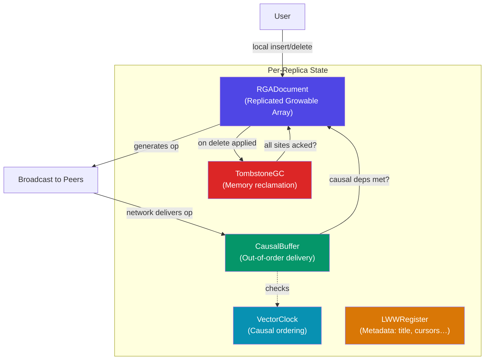
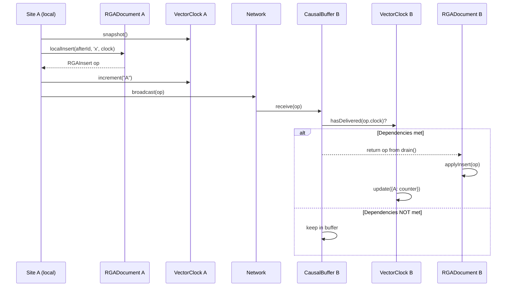
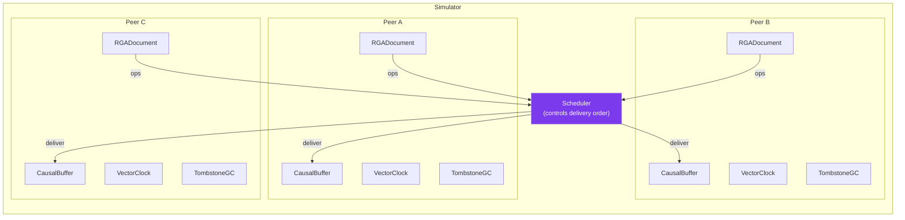

# CRDT Collaborative Text Editor — Architecture Overview

## What Is This Project?

This is a **Conflict-free Replicated Data Type (CRDT) engine** for collaborative text editing — think Google Docs, but with a decentralised, peer-to-peer approach. Multiple users can edit the same document simultaneously, even while offline, and the system **guarantees** that all replicas eventually converge to the same result without a central server arbitrating conflicts.

The engine is written in TypeScript and lives entirely in `crdt-engine/`. There is no UI or networking layer yet — it's a pure data-structure library with a test suite.

---

## Architecture at a Glance



---

## Component Breakdown

### 1. RGADocument — The Document Model
**Files:** [RGADocument.ts](file:///c:/Users/lohah/OneDrive/Desktop/sem2/distri/CRDT_collaborative_text_editor/crdt-engine/src/rga/RGADocument.ts), [RGANode.ts](file:///c:/Users/lohah/OneDrive/Desktop/sem2/distri/CRDT_collaborative_text_editor/crdt-engine/src/rga/RGANode.ts)

The core data structure — a **linked list** where each node represents a single character. Every node has a globally unique `NodeId = { siteId, counter }`.

| Capability | Method | Description |
|---|---|---|
| Local edit | `localInsert(afterId, char, clock)` | Creates an insert op, applies it locally, returns the op to broadcast |
| Local edit | `localDelete(nodeId, clock)` | Creates a delete op (tombstone), returns the op to broadcast |
| Remote apply | `applyInsert(op)` / `applyDelete(op)` | Applies an incoming remote operation |
| Read | `toVisibleString()` | Returns the current visible text (skips tombstones) |
| Cursor support | `getNodeIdAtOffset(n)` / `getAfterIdForOffset(n)` | Converts cursor positions ↔ stable NodeIds |

**Conflict resolution rule:** When two concurrent inserts target the same predecessor, the one with the **lexicographically higher `siteId`** goes to the left. Ties on `siteId` are broken by higher `counter`. This is deterministic and total, so every replica converges.

**Deletions** are soft-deletes: the node stays in the list (`isDeleted = true`) to preserve ordering for any future inserts that reference it.

---

### 2. VectorClock — Causal Ordering
**File:** [VectorClock.ts](file:///c:/Users/lohah/OneDrive/Desktop/sem2/distri/CRDT_collaborative_text_editor/crdt-engine/src/clocks/VectorClock.ts)

A standard vector clock tracking `clock[siteId] = count_of_ops_seen_from_that_site`.

| Method | Purpose |
|---|---|
| `increment(siteId)` | Called when the local site generates an op |
| `update(remote)` | Merge a remote clock (take component-wise max) |
| `snapshot()` | Export current state to attach to outgoing ops |
| `happensBefore(other)` | True if this clock causally precedes the other |
| `isConcurrent(other)` | True if neither clock precedes the other |
| `hasDelivered(dep)` | True if all dependencies in `dep` are already satisfied locally |

---

### 3. CausalBuffer — Out-of-Order Delivery Handler
**File:** [CausalBuffer.ts](file:///c:/Users/lohah/OneDrive/Desktop/sem2/distri/CRDT_collaborative_text_editor/crdt-engine/src/clocks/CausalBuffer.ts)

Network messages can arrive out of order. The CausalBuffer holds incoming ops until their **causal dependencies** are satisfied:

1. `receive(op)` → pushes the op into a pending queue
2. `drain()` → iterates the queue, releases ops whose `op.clock` is dominated by the local VectorClock (meaning all prerequisite ops have been applied), and returns them in safe-to-apply order
3. The caller applies the released ops to `RGADocument` and updates the VectorClock

---

### 4. LWWRegister — Document Metadata
**File:** [LWWRegister.ts](file:///c:/Users/lohah/OneDrive/Desktop/sem2/distri/CRDT_collaborative_text_editor/crdt-engine/src/lww/LWWRegister.ts)

A **Last-Writer-Wins Register** for metadata like document title, cursor positions, user names — anything that isn't character-level text. Conflict resolution: highest timestamp wins; ties broken by higher `siteId`.

---

### 5. TombstoneGC — Memory Reclamation
**File:** [TombstoneGC.ts](file:///c:/Users/lohah/OneDrive/Desktop/sem2/distri/CRDT_collaborative_text_editor/crdt-engine/src/rga/TombstoneGC.ts)

Over time, deleted characters pile up as tombstones in the linked list. TombstoneGC physically removes them **only after every known site has acknowledged the deletion**:

1. `registerSite(siteId)` — register all participating peers
2. `acknowledge(nodeId, siteId)` — record that a site applied a delete
3. `collect(doc)` — prune all fully-acked tombstones from the `RGADocument`

---

### 6. Types — Shared Contracts
**File:** [types.ts](file:///c:/Users/lohah/OneDrive/Desktop/sem2/distri/CRDT_collaborative_text_editor/crdt-engine/src/types.ts)

Defines `SiteId`, `NodeId`, `VectorClockSnapshot`, `RGAInsert`, `RGADelete`, and helper functions (`nodeKey`, `nodeIdEqual`).

---

## How a Typical Edit Flows



---

## How to Build a Simulator

The engine has no networking — it's designed to be exercised in-process. Here's how to build a **multi-peer simulator** that ties everything together.

### Simulator Architecture



### Step-by-Step Implementation

#### 1. Define a `Peer` class

```typescript
// simulator/Peer.ts
import { RGADocument } from '../src/rga/RGADocument';
import { VectorClock } from '../src/clocks/VectorClock';
import { CausalBuffer } from '../src/clocks/CausalBuffer';
import { TombstoneGC } from '../src/rga/TombstoneGC';
import { RGAOperation, RGAInsert, RGADelete } from '../src/types';

export class Peer {
  readonly siteId: string;
  readonly doc: RGADocument;
  readonly clock: VectorClock;
  readonly buffer: CausalBuffer;
  readonly gc: TombstoneGC;

  /** Outbox: ops generated locally, waiting to be "sent" by the scheduler */
  readonly outbox: RGAOperation[] = [];

  constructor(siteId: string) {
    this.siteId = siteId;
    this.doc = new RGADocument(siteId);
    this.clock = new VectorClock();
    this.buffer = new CausalBuffer(this.clock);
    this.gc = new TombstoneGC();
  }

  /** Local insert at a cursor offset */
  insertAt(offset: number, char: string): RGAInsert {
    const afterId = this.doc.getAfterIdForOffset(offset);
    const clockSnap = this.clock.snapshot();
    const op = this.doc.localInsert(afterId, char, clockSnap);
    this.clock.increment(this.siteId);
    this.outbox.push(op);
    return op;
  }

  /** Local delete at a cursor offset */
  deleteAt(offset: number): RGADelete | null {
    const nodeId = this.doc.getNodeIdAtOffset(offset);
    if (!nodeId) return null;
    const clockSnap = this.clock.snapshot();
    const op = this.doc.localDelete(nodeId, clockSnap);
    this.clock.increment(this.siteId);
    this.outbox.push(op);
    return op;
  }

  /** Receive a remote op (goes into the causal buffer) */
  receive(op: RGAOperation): void {
    this.buffer.receive(op);
  }

  /** Drain the causal buffer and apply all ready ops */
  applyReady(): number {
    const ready = this.buffer.drain();
    for (const op of ready) {
      if (op.type === 'insert') this.doc.applyInsert(op);
      else this.doc.applyDelete(op);
    }
    return ready.length;
  }

  /** Current visible text */
  get text(): string {
    return this.doc.toVisibleString();
  }
}
```

#### 2. Define a `Scheduler` — The Network Simulator

```typescript
// simulator/Scheduler.ts
import { RGAOperation } from '../src/types';
import { Peer } from './Peer';

type PendingDelivery = {
  op: RGAOperation;
  from: string;        // source siteId
  to: string;          // destination siteId
  delay: number;       // simulated ticks before delivery
};

export class Scheduler {
  private peers: Map<string, Peer> = new Map();
  private queue: PendingDelivery[] = [];
  private tick: number = 0;

  addPeer(peer: Peer): void {
    this.peers.set(peer.siteId, peer);
    // Register with all GCs
    for (const p of this.peers.values()) {
      p.gc.registerSite(peer.siteId);
    }
  }

  /** Flush all peer outboxes into the delivery queue */
  collectOutboxes(delayFn?: () => number): void {
    for (const peer of this.peers.values()) {
      while (peer.outbox.length > 0) {
        const op = peer.outbox.shift()!;
        for (const target of this.peers.values()) {
          if (target.siteId === peer.siteId) continue;
          this.queue.push({
            op,
            from: peer.siteId,
            to: target.siteId,
            delay: delayFn ? delayFn() : 0,  // 0 = immediate
          });
        }
      }
    }
  }

  /** Advance one tick: deliver any messages whose delay has elapsed */
  step(): number {
    this.tick++;
    let delivered = 0;

    const stillPending: PendingDelivery[] = [];
    for (const msg of this.queue) {
      if (msg.delay <= this.tick) {
        const target = this.peers.get(msg.to)!;
        target.receive(msg.op);
        target.applyReady();
        delivered++;
      } else {
        stillPending.push(msg);
      }
    }
    this.queue = stillPending;
    return delivered;
  }

  /** Run until all queues are empty */
  drainAll(): void {
    this.collectOutboxes();
    let maxIter = 1000;
    while (this.queue.length > 0 && maxIter-- > 0) {
      this.step();
    }
  }

  /** Check convergence: all peers see the same text */
  checkConvergence(): { converged: boolean; texts: Record<string, string> } {
    const texts: Record<string, string> = {};
    for (const [id, peer] of this.peers) {
      texts[id] = peer.text;
    }
    const values = Object.values(texts);
    return {
      converged: new Set(values).size === 1,
      texts,
    };
  }
}
```

#### 3. Write Simulation Scenarios

```typescript
// simulator/run.ts
import { Peer } from './Peer';
import { Scheduler } from './Scheduler';

function scenario_basicConvergence() {
  console.log('=== Scenario: Basic 3-peer convergence ===');
  const scheduler = new Scheduler();
  const alice = new Peer('alice');
  const bob   = new Peer('bob');
  const carol = new Peer('carol');
  scheduler.addPeer(alice);
  scheduler.addPeer(bob);
  scheduler.addPeer(carol);

  // Each peer types independently (concurrent edits)
  alice.insertAt(0, 'A');
  bob.insertAt(0, 'B');
  carol.insertAt(0, 'C');

  // Deliver all messages
  scheduler.drainAll();

  const result = scheduler.checkConvergence();
  console.log('Converged:', result.converged);
  console.log('Texts:', result.texts);
  // Expected: all three see the same 3-char string
}

function scenario_concurrentDeleteAndInsert() {
  console.log('\n=== Scenario: Concurrent delete + insert ===');
  const scheduler = new Scheduler();
  const alice = new Peer('alice');
  const bob   = new Peer('bob');
  scheduler.addPeer(alice);
  scheduler.addPeer(bob);

  // Shared history: "hello"
  for (const ch of 'hello') alice.insertAt(alice.doc.getVisibleLength(), ch);
  scheduler.drainAll();

  console.log('Before:', alice.text, bob.text);

  // Alice inserts '!' at the end, Bob deletes 'e' (index 1)
  alice.insertAt(5, '!');
  bob.deleteAt(1);

  scheduler.drainAll();

  const result = scheduler.checkConvergence();
  console.log('After:', result.texts);
  console.log('Converged:', result.converged);
}

function scenario_outOfOrderDelivery() {
  console.log('\n=== Scenario: Out-of-order delivery (CausalBuffer) ===');
  const scheduler = new Scheduler();
  const alice = new Peer('alice');
  const bob   = new Peer('bob');
  scheduler.addPeer(alice);
  scheduler.addPeer(bob);

  // Alice types "abc" — three ops with causal chain
  alice.insertAt(0, 'a');
  alice.insertAt(1, 'b');
  alice.insertAt(2, 'c');

  // Manually deliver in REVERSE order to Bob (simulating network reordering)
  const ops = [...alice.outbox];
  alice.outbox.length = 0; // clear

  bob.receive(ops[2]!); // 'c' first — depends on 'b'
  bob.receive(ops[0]!); // 'a' — no deps
  bob.applyReady();
  console.log('After delivering c,a:', bob.text); // only 'a' should appear

  bob.receive(ops[1]!); // 'b' — now deps for 'c' are also met
  bob.applyReady();
  console.log('After delivering b:', bob.text);   // 'abc'
}

// Run all scenarios
scenario_basicConvergence();
scenario_concurrentDeleteAndInsert();
scenario_outOfOrderDelivery();
```

### Running the Simulator

```bash
# From the crdt-engine directory:
npx ts-node simulator/run.ts
```

Or add a script to `package.json`:
```json
"scripts": {
  "simulate": "ts-node simulator/run.ts"
}
```

### Ideas for Advanced Simulation

| Scenario | What to test |
|---|---|
| **Random delay** | Use `delayFn: () => Math.floor(Math.random() * 10)` to simulate variable network latency |
| **Network partition** | Don't deliver messages for N ticks, accumulate edits, then reconnect and verify convergence |
| **Fuzz testing** | Randomly generate insert/delete ops across many peers, deliver in random order, assert convergence |
| **Tombstone GC** | After concurrent deletes + acks from all peers, call `gc.collect(doc)` and verify memory shrinks |
| **Large document** | Insert thousands of characters and measure convergence time + memory |

> [!TIP]
> The existing convergence tests in [convergence.test.ts](file:///c:/Users/lohah/OneDrive/Desktop/sem2/distri/CRDT_collaborative_text_editor/crdt-engine/tests/rga/convergence.test.ts) already validate the core CRDT properties (commutativity, idempotency, tie-breaking) at the `RGADocument` level. The simulator adds the **VectorClock + CausalBuffer** layer on top — which is the integration you need to prove the full system works end-to-end.
